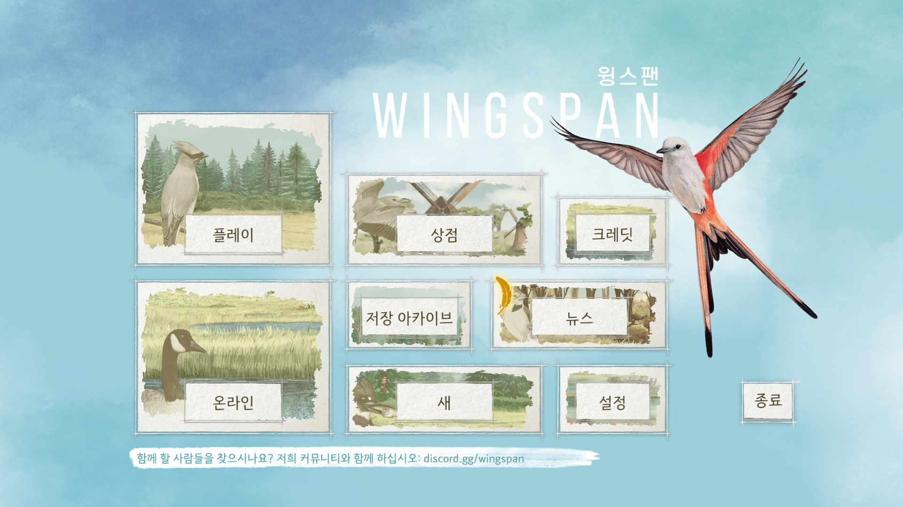
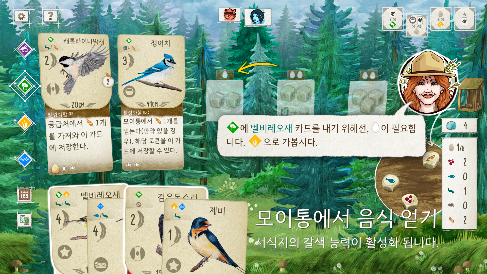
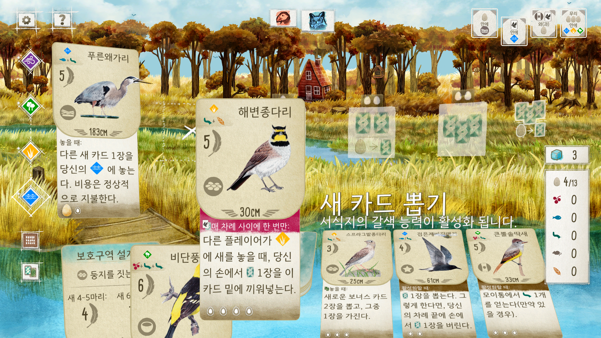
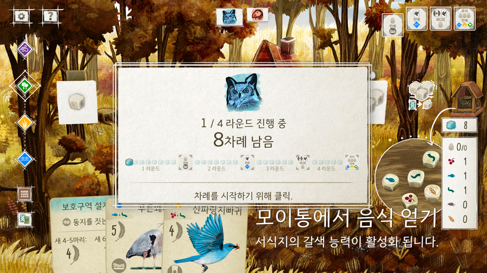
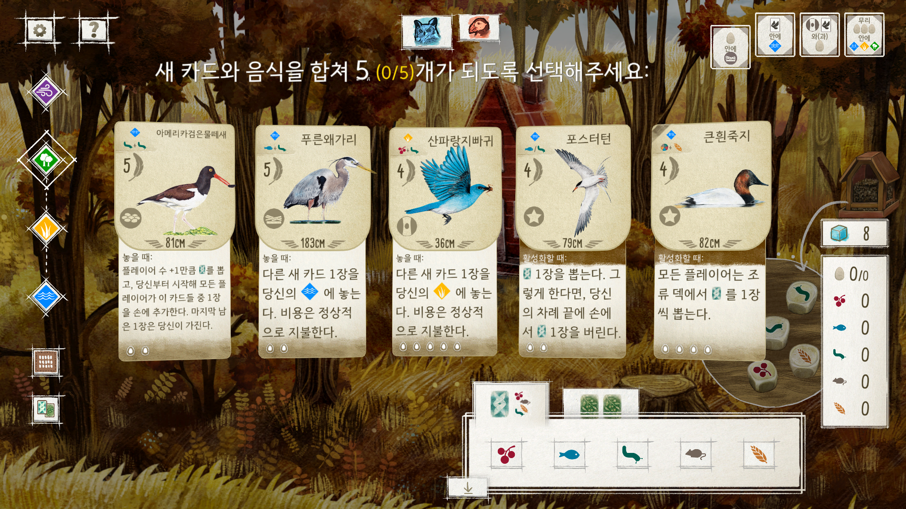

## Wingspan 한글 폰트 변경 모드

### 설치
1. Wingspan 스팀 경로에 [BepInEx IL2CPP x86](https://builds.bepinex.dev/projects/bepinex_be) 설치
2. 게임 실행 및 메인 메뉴 확인 후 종료
3. 압축 파일을 아래 경로에 각각 추가       
      |파일|경로|
      |------|---|
      |**WingspanKoreanFont.dll**|Wingspan\BepInEx\plugins|
      |**BusanDandiGothicM.ttf**|Wingspan\BepInEx\plugins\KoreanFont|

### 제거
WingspanKoreanFont.dll 삭제

### 참고
- GitHub 링크를 제외한 모든 재배포 금지
- 업데이트 후 BepInEx의 파일 재생성 필요
- Wingspan © 2026 Stonemaier Games. Wingspan은 Stonemaier Games의 등록 상표입니다.
- Wingspan Digital Version © 2026 Monster Couch. All rights reserved. 
- 부산 단디고딕체 © 2026 부산광역시. All rights reserved.

### 스크린샷

### 문의

contact@youngsan.org